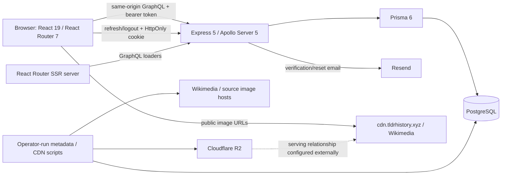

# Repository architecture baseline

Audited on 2026-10-11 (Asia/Singapore), against working-tree source based on commit `fe131e270e509ebdc65899da5604d8aa8884bacf`. This describes the repository, not an attestation of the running production system. Findings and investigation priorities are in [risk-register.md](risk-register.md).

## Scope and evidence

The review covered the registered GraphQL queries and mutations, schema and Prisma migrations, Express middleware and authentication routes, React Router routes and loaders, authentication/filter/era contexts, query hooks and mutations, timeline and profile rendering, review forms, map rendering, image scripts, Dockerfiles, workflows, and configuration examples. Generated GraphQL types and installed dependency implementations were consulted where needed to distinguish declarations from actual behavior.

Only these two audit documents were created. No application, deployment, migration, configuration, or dependency files were changed. No service was started, database contacted, migration or seed executed, email sent, image uploaded, or production endpoint probed. Local checks used existing dependencies, in-memory transpilation, and stubbed database/network operations; they created no test files.

The starting checkout already had deleted `deployment-contract.md`, `docs/vps-staging.md`, and `new-application.md`, plus untracked `frontend/AGENTS.md`, `frontend/public/tldr-history-logo.svg`, and `frontend/src/assets/`. These were preserved. The frontend guidance describes a future redesign; the user's baseline-only request governs this audit. Deleted deployment documents were not treated as current infrastructure evidence. Git reads used a command-scoped safe-directory setting; no Git configuration was changed.

## System map

| Boundary | Implementation and responsibilities |
|---|---|
| Frontend | `frontend/app` owns React Router framework routes, document shell, metadata and server loaders. `frontend/src/features` holds timeline, filter, profile, review, form and stats behavior; shared components and contexts live under `src/components` and `src/context`. React 19, TypeScript, Tailwind 4/DaisyUI, Framer Motion, TanStack Query 5, Axios, Masonic and D3 are declared dependencies. |
| API | `backend/src/index.ts` listens; `app.ts` installs middleware, health checks, REST authentication and Apollo. `schema/typeDefs.ts` declares SDL; `schema/resolvers/index.ts` merges query/mutation exports. The context used in production is inline in `app.ts`, not the separate `schema/context.ts` helper. |
| Persistence | One module-level Prisma client in `backend/src/server/client.ts`; PostgreSQL configured through `DATABASE_URL`. Resolvers call Prisma directly rather than through an authorization-aware repository layer. |
| External services | Resend for account emails; Wikimedia for metadata/image lookup; S3-compatible SDK and Sharp for operator-run R2 ingestion. Retired AI generation code is present but not wired into the active request graph found in this review. |
| Deployment | Separate frontend/backend Docker images and staging workflows are present. A combined API-plus-SSR path also remains in `backend/src/app.ts`. Caddy/VPS routing is described in README and comments; actual host/proxy configuration is absent from the current tree. |

## Routes, rendering and client/server state

`frontend/app/routes.tsx` defines `/`, `/timeline`, `/timeline/:groupSlug`, account routes (`/register`, `/login`, `/forgot-password`, `/reset-password`, `/verify`), `/user/:id`, `/articles/create`, `/articles/edit/:id`, `/review-suggestions`, legal pages, and a wildcard page. Articles are primarily timeline cards with modal details; no individual public article-detail route is declared. Profile cards reuse card content but do not wire the timeline's card-opening modal handler.

`app/root.tsx` wraps the application in the singleton QueryClient provider, ToastProvider and AuthProvider. RootLayout renders the navigation, background and outlet. The layout route provides `ErrorBoundary`, backed by `src/pages/Error.tsx`. Protected pages use a client component, `RequireAuth`, which initially renders a loading indicator, then checks token, optional email verification and optional role. There are no server authentication loaders for those pages; API authorization is therefore the effective enforcement boundary.

`react-router.config.ts` enables SSR. Its normal build configuration prerenders static paths and known theme timelines; the frontend Docker build sets `DISABLE_PRERENDER=true`. Vite proxies `/graphql` and `/api` to localhost:5000 in development. Browser GraphQL calls use `/graphql`; browser refresh/logout use `/api/*`. Server GraphQL defaults to `API_ORIGIN`, then `VITE_API_ORIGIN`, then localhost:5000. The profile loader instead explicitly passes the incoming request's origin to its GraphQL fetch, so it has a different routing dependency from the timeline loader.

Server loaders exist for the two timeline leaf routes and user profiles. Timeline loaders derive filters from the request URL, fetch one anonymous page, and return `{filter, initialData, viewerId: "anonymous"}`. `useTimeline` uses that page as TanStack infinite-query initial data only for the anonymous viewer. Authentication is established after mounting by refreshing the cookie session; authenticated timeline queries then use a viewer-specific key. Loader cookies or bearer tokens are not forwarded by the timeline loader.

The profile loader calls `queryClient.ensureQueryData` for public stats and returns them for metadata. Its component independently calls `useUserStatsQuery` and does not initialize that query from loader data. There is no explicit QueryClient dehydration/HydrationBoundary wiring in the application. The exported QueryClient is process-wide during SSR and browser-wide on the client. This is a concrete coupling relevant to profile hydration and cache lifetime; cross-user leakage from SSR has **not** been demonstrated, because the inspected server loaders fetch public data.

## Authentication, sessions and authorization

1. `register` normalizes email and username, checks for a duplicate, bcrypt-hashes the password at cost 12, creates a USER, creates an email token, attempts delivery, and issues access/refresh tokens. It accepts GraphQL strings without the frontend registration schema's password/format checks. User creation, token creation and mail delivery are separate operations.
2. `login` normalizes email, selects the password hash and current role, compares bcrypt, and returns a safe user projection plus access token. Neither login nor registration requires prior email verification. Registration fixes role to USER; callers cannot supply a role argument.
3. `issueTokens` signs a 15-minute access JWT containing ID, email and role and a seven-day refresh JWT containing ID and a random JTI. It stores the **raw refresh JWT** in `RefreshToken.token` and sets a host-only cookie with HttpOnly, SameSite=Lax, Path=/, and Secure in production. The access token lives in React/module memory, not localStorage.
4. `POST /api/refresh` verifies the refresh signature, looks up an unexpired token row, loads the current user, deletes the old row, creates a successor, and sets a new cookie inside/after an interactive Prisma transaction. The code does not check the old-token deletion count or track token families/reuse. Concurrent consumption semantics need database verification.
5. `POST /api/logout` deletes the presented refresh row, clears the cookie, and returns 200 even when deletion throws. Expired-token cleanup follows asynchronously. Password reset deletes all refresh rows for the user. Existing access JWTs remain usable until expiry: request context verifies signatures and does not consult a revocation list or reload roles. This also bounds how quickly a role change takes effect for an already-issued token.
6. Verification/reset links contain 32-byte random tokens. Only bcrypt hashes are stored in `AuthToken`, unique per `(userId,type)`, with 24-hour verification and one-hour reset expiry. Matching loads all unused/unexpired tokens of the requested type, including users, and compares hashes sequentially. Token eligibility is checked before the transaction that marks it used. Reset updates password, marks the token used and removes refresh sessions, then issues a new session.
7. AuthProvider refreshes on mount and schedules renewal 30 seconds before access expiry. The Axios interceptor queues simultaneous interceptor-triggered renewals, but startup, timer and verification-page renewals use additional calls outside that queue. Logout neither clears the QueryClient nor cancels an in-flight renewal. Timer/startup failures and API authentication error handling are not equivalent paths.

Relevant files: `backend/src/schema/resolvers/mutation/auth.ts`, `backend/src/routes/authRoutes.ts`, `backend/src/lib/tokens.ts`, `backend/src/utils/auth/*`, `frontend/src/context/AuthContext.tsx`, and `frontend/src/lib/api.ts`, `authSession.ts`, `requireAuth.tsx`.

### Server authorization matrix

| Operations | Actual server enforcement / exposure |
|---|---|
| `timeline`, `userPosts`, `userLikes`, `userStats` | Public. Profiles expose contributions, liked posts, role on profile post authors, membership date and email-verification timestamp. Timeline's anonymous `viewerId` argument can select another user's like flags; likes are already public through `userLikes`. This is not independently established as a private-data IDOR. |
| `getPopulation`, `getSignificant`, `getCivilisation`, `formLists` | Public historical/reference data. |
| `pendingStats` | Public moderation aggregate counts; unlike both queue queries, no role check. |
| `pendingEdits`, `pendingCreatedPosts` | MODERATOR or ADMIN. |
| `getPost` | USER, MODERATOR or ADMIN. Any published post ID; ownership is not required for proposing edits to shared content. |
| `createPostSuggestion`, `suggestEdit` | USER, MODERATOR or ADMIN. Author is taken from context, not input. No server email-verification check. |
| Approve/reject created posts and edits | MODERATOR or ADMIN. No self-review prohibition in code. |
| `deletePost` | ADMIN only, even for a post's owner. |
| `likePost` | Any authenticated context; user ID comes from context. |
| `savedFilters`, `saveFilter` | Authenticated user; reads/writes scoped to context user. |
| `editSavedFilter`, `deleteSavedFilter` | Authenticated user; lookup checks both filter ID and owner before update/delete by ID. No ownership-changing API was found. |
| Account mutations | Register/login/forgot/reset/verify public; resend requires authentication and reloads the user. |
| `postTimeline`, `editTimeline` | Declared in SDL but no corresponding registered resolver. Default resolution returns null and violates their non-null return type. They are not functioning unguarded write endpoints. |

`requireAuth`/`requireRole` throw ordinary `Error`s. There is no Prisma-level row authorization layer in repository code. All registered privileged mutations inspected have the role/auth checks above; no public role-changing mutation was found.

## GraphQL contracts and database behavior

The resolver registry contains only Query and Mutation maps: there are no custom User/Post/relation field resolvers or request-scoped DataLoaders. Nested fields use GraphQL default property resolution over Prisma projections. A schema relation alone therefore does **not** cause a fresh unauthorized database read. Public post projections select author ID/username (and additional profile fields in profile queries), not author email or password. Full `suggestedBy` includes on submission mutations refer to the submitting user. Password is not a GraphQL field. No nested route to another user's email/password was established.

Several SDL objects are broader than returned projections: examples include non-null `User.email`, `Post.createdAt`, `Post.likes` on `getPost` and review projections, `Subject.posts`, and pending edit timestamps. Requesting those absent fields can cause null propagation rather than relation loading. Actual frontend operations select narrower subsets and mostly avoid these failures. JSON suggestion data is not a general JSON mutation input: contributions enter through typed `PostInput`, then Zod. Saved filters have typed input plus custom normalization. Cursor decoding checks only some payload types; malformed month/day values can reach Prisma validation. Stats resolvers do not run timeline's full Zod filter parser.

Apollo formats errors to `{message, extensions.code}`, logs the original error, and defaults unclassified errors to INTERNAL_SERVER_ERROR. It removes extra extensions from the response but retains the original message, including possible ORM details. Axios's GraphQL helper throws on the first error and discards other errors and partial data. HTTP array batching is disabled by Apollo's installed default; aliases within a single operation remain available. No explicit operation-cost/alias limit is configured.

Prisma models are User, Post, Country, Subject, Group, Like, Summary, Population, CreatedPost, EditSuggestion, RefreshToken, AuthToken and SavedFilter, plus the implicit post-subject join. Like has composite primary key `(userId,postId)`; user email/username, post name and group/subject names are unique. CreatedPost has a unique nullable post link. SavedFilter has owner/name uniqueness and an owner index. AuthToken has token-hash/expiry/usedAt indexes and owner/type uniqueness. Post indexes cover `(startYear,endYear)`, significance, country, group and author. There is no index specifically on Like.postId, moderation `(status,createdAt)`, or the complete timeline sort tuple in the checked schema/migrations. Performance effects require representative EXPLAIN plans; their absence alone is not a proven latency defect.

Transactions protect approve-and-publish/update, post deletion with dependent rows, like toggle, refresh rotation, and reset/verification writes. Approval status reads and subsequent writes are not conditional transitions; edit suggestions store full snapshots without a base post version. Like toggles and the three-saved-filter cap also use read-then-write transactions without explicit isolation settings. Foreign keys and uniqueness prevent some inconsistent writes, but application authorization and conflict policy remain in resolver code.

Nine current SQL migrations run from the December 2025 initial schema through April 2026 saved-filter JSON state. The review-enum migration drops and recreates statuses with `pending`; the two saved-filter conversions drop prior state and add required columns without a data conversion/default. Application schema and migration SQL contain no date-order/check constraints. No migration was executed or compared with a live migration ledger.

## Moderation and contribution flow

Verified users reach CreateArticle/Edit through RequireAuth; PostForm uses a reducer and client Zod schema, then submits a GraphQL mutation. The API separately validates `inputSchema` and stores normalized JSON in CreatedPost or EditSuggestion. Creating a suggestion scans existing post names for normalized duplicates; pending duplicate submissions are not included in that check.

The review page loads both pending queues and aggregate status counts. `pendingEdits` derives field differences against the **current** post through `buildChanges`; the UI separates descriptions, metadata and image changes. Approving a creation validates JSON again and transactionally creates a Post and marks the submission approved. Approving an edit writes its full validated snapshot, replaces subject relations and marks the suggestion approved. Ownership transfers from BOT/`HistOracle` posts to the suggesting user. Other ownership is preserved. Reject updates only status/moderator after checking pending state. Delete removes likes and review records before deleting the post in one transaction.

Image-related edits clear CDN fields and mark the image pending. Edit form data currently loses significance values through a shadowed `data` parameter; approval then writes Zod's zero defaults, and the visible review-diff builder does not render significance fields. This is an established data-flow defect, detailed in R01.

## Timeline, navigation, era and map flow

1. FilterContext derives applied state from the theme slug plus `q`, `t`, `s`, `c`, `ys`, `ye`, and `o` query parameters. Subject/type/continent are multiselect arrays; theme is a single numeric group resolved through static frontend metadata. Defaults are years -300000 through 2025 and ascending order. Backend validators accept up to 2026, while UI controls/schemas still cap at 2025.
2. Filter changes navigate with history replacement by default. Drawer checkboxes apply immediately; search and year fields debounce for 300 ms. There is no general draft/apply layer. Saved filters persist names and state as owner-scoped JSON; sharing builds a URL with an optional era-view `v` parameter.
3. The server timeline resolver validates filters, builds Prisma conditions, fetches 15 rows sorted by `(startYear,startMonth,startDay,id)`, fetches the viewer's likes for those IDs, and returns a base64 JSON keyset cursor. Ascending/descending comparisons match the sort tuple. Every nonempty page has a cursor, so exhaustion requires an extra empty request. Search is case-insensitive substring matching across name/descriptions, not a separate full-text search service.
4. Date filtering includes posts whose start falls in range, or whose nonzero end falls in range with end significance greater than 0.5. It is not general interval-overlap filtering. Keyset positions are based on mutable dates; no snapshot consistency or client ID deduplication is implemented across page requests.
5. `useTimeline` keys pages by `["timeline","list",filter,viewerKey]`, uses 30-second staleness, retains previous pages only across compatible filter/viewer transitions, and flattens pages. Anonymous refetch-on-mount is disabled; signed-in mounting always refetches. A new anonymous key receives loader initial data without checking equality with the returned loader filter.
6. SSR and the first client render use CSS columns. An effect then adds Masonic, with 350-pixel target column width, 24-pixel gap, estimated 400-pixel cards, up to two columns, and load-more threshold 10. **The static grid remains mounted, hidden, for every loaded post.** Static and virtual cards share the same per-post object refs. Cards load images eagerly without stored intrinsic dimensions; Masonic handles its own measurement.
7. Actual era tracking is a passive **window scroll listener plus requestAnimationFrame and bounding-rectangle reads**, not an application IntersectionObserver. It searches card refs in chronological array order for a top candidate and updates EraContext's `dataStartYear`. Appending/replacing posts resets its search index. It uses viewport top zero, without subtracting the fixed header; masonry visual order can differ from array order. Browser verification of visible-year selection remains outstanding.
8. EraContext derives era ranges/headline/icon from a static range set and `dataStartYear`. Geographic era view and geographic content filters are separate states. `v` initializes view once after mount and is removed with direct `history.replaceState`; later `setView` changes context only. `setEra` clamps the context year but is not wired to a loaded-post scroll navigation control in the inspected UI.
9. TimelineHeader and TimelineStats consume era/filter state. Population is global by era start; significance/civilisation queries use era and filters. Their 30-minute caches retain previous data during transitions. WorldMap additionally filters civilisations to the exact current year and groups them by normalized modern-country name.
10. WorldMap lazily imports local TopoJSON, converts it once into a module-cached FeatureCollection, fits a Natural Earth projection and draws country paths. Country-centroid dots use summed significance, group/continent colors and 300 ms transitions. This is a modern-country point map, not historic boundary polygons or computed migration paths. Tooltip content uses D3 `.html()` with stored post names. Interactive dot clicks scan cached timeline pages for the first matching civilisation; there is no fallback fetch if that post has not been loaded.

The page uses window scrolling, fixed header/stats surfaces and main-content offsets. ScrollManager disables native restoration and scrolls to zero only when it mounts. No route-keyed scroll restoration or filter-change reset was found. Card/modal state stores a post snapshot, so subsequent query updates do not automatically replace an already-open modal's data. ModalShell portals after mount, handles Escape/outside click and body overflow; nested overlay locking and focus behavior were not browser-tested.

## Query cache and invalidation map

| Data | Key / policy | Writes and consistency coupling |
|---|---|---|
| Timeline | Filter plus viewer; 30 seconds; infinite pages | Approval/deletion invalidate `timeline` prefix. Like success changes only the mounted CardFooter's local state; timeline cache is not updated. |
| User posts/likes | Profile user ID, **not viewing account**; 30 minutes | Response includes viewing account's `liked`. Likes invalidate userLikes only; author posts/stats are not comprehensively invalidated by likes, approvals or deletion. |
| User stats | Profile user ID; 30 minutes; singleton used by SSR loader | Browser cache is separate from server cache; loader result is not passed into the component query. |
| Saved filters | `["savedFilters", variables ?? null]`; five minutes | No viewing account in key. Mutations invalidate the prefix; login/logout do not clear it. Hook runs even before the component's logged-out rendering check. |
| Review queues/stats | Global keys `pendingEdits`, `pendingCreatedPosts`, `pendingStats` | Approval/rejection invalidate the relevant queue; aggregate stats are not invalidated by these hooks. |
| Population/significance/civilisations | Year/range/filter variants; 30 minutes | Previous data remains during transitions; article writes do not invalidate these keys. |

There is no explicit global retry policy on QueryClient. Hooks generally inherit installed TanStack Query defaults; mutations do not configure automatic retries. Query functions do not pass cancellation signals to Axios. `useTimeline` returns errors, but Timeline does not consume them: later-page failures lack a visible retry/error state. Profile tab lists have an error state; create/edit pages can return null when their data query fails. Review mutations reset button state without a dedicated error display in the inspected panels.

## Images and storage

No browser binary-upload endpoint, multipart middleware, presigned URL issuer or private-image authorization flow was found. The user form submits image/source URL strings. Approved article content is public; images are served by public URLs. The repository does not establish R2 bucket policy or the CDN's access/cache configuration.

`metadataAudit.ts` selects pending-image posts, calls Wikimedia APIs, derives licensing/credit metadata, and writes image status/URL/credit. It is a mutating operator script despite its name. Its license-string classifier is heuristic, and it can preserve an original URL after matching only its filename to Wikimedia metadata. `cdnUpload.ts` selects approved images with no CDN URL, downloads the source (following redirects), checks the response's `image/` MIME prefix, rejects SVG, uses Sharp to decode/resize to at most 230-pixel height and encode WebP, then writes an R2 object. Keys are SHA-1 hashes of source URLs, not content. Objects get `image/webp` and public one-year immutable caching; a HEAD check skips existing objects. Prisma is updated after upload, outside an object-storage/database transaction.

The uploader has concurrency one and a two-second rate interval, aborts work on HTTP 429, marks 404 images rejected, and logs other per-post failures. Its fetch timeout ends once response headers arrive; body buffering has no explicit byte limit or continuing application timeout. There is no schedule invoking these scripts in the checked workflows/server. The `imageAudit` npm command references `metadataAudit.js` under src, while the checked source file is `.ts`; successful operational invocation was not verified.

Frontend cards, modal and stats reconstruct `https://cdn.tldrhistory.xyz/${cdnId}` or fall back to `imageUrl`; they do not generally consume stored `cdnUrl` or enforce `imageStatus`. The public API projection omits status. Therefore pending image status is not itself a frontend display gate. CSP permits self/data/CDN/Wikimedia images. Actual arbitrary-host image loading depends on delivered headers; it was not tested.

## Deployment and configuration as checked in

Both Dockerfiles use Node 22.20.0 bookworm-slim, separate build/runtime stages, `npm ci`, dev-dependency pruning, and non-root `node` runtime users. Backend installs OpenSSL, generates Prisma, compiles TypeScript, retains migrations/Prisma tooling, and runs `node dist/index.js` on 5000 with `SERVE_FRONTEND=false`. Frontend builds React Router with prerendering disabled and runs `server.mjs` on 3000. That server serves immutable hashed assets, other static assets with one-hour caching, and SSR requests through the React Router Express adapter.

The combined backend path is enabled unless `SERVE_FRONTEND=false`; it serves SSR only if `public/build/server/index.js` exists. This is retained Render behavior in source/README, not confirmation of current Render hosting or database location.

`staging-deploy.yml` builds both images for pull requests and master pushes. Master pushes rebuild/publish linux/amd64 images to GHCR, extract immutable digests, and use a staging-environment SSH command `deploy <frontend digest> <backend digest>`. SSH uses the configured known-hosts file and strict checking. It then checks `/health/ready` for an exact marker. The rollback workflow accepts `recover`/`rollback`, calls the corresponding remote command, and repeats readiness checking. Deployment/rollback share a concurrency group. Neither workflow invokes database migrations or seeds. The remote command implementation, compose/services, volumes, actual Caddy rules, branch protections and environment approvals are not in this checkout.

Backend liveness returns plain text; readiness waits for Apollo initialization and a `SELECT 1`, not a schema-level or frontend smoke test. Backend SIGTERM/SIGINT closes the HTTP listener, then Apollo and Prisma. Frontend signals close its listener. Both servers apply compression/Helmet; backend also applies CORS and a 15-second response timeout. GraphQL IP limiting is 120 requests/minute plus 20 auth-containing requests/10 minutes; `/api` limiting applies only when `TRUST_PROXY=1`. Limits are in-process. CSP explicitly allows inline scripts; installed Helmet also contributes `script-src-attr 'none'`, which matters when assessing tooltip exploitability.

Configuration names in active paths: `DATABASE_URL`, `JWT_SECRET`, `JWT_REFRESH_SECRET`, `EMAIL_DELIVERY_MODE`, `RESEND_API_KEY`, `APP_ORIGIN`, `FRONTEND_ORIGINS`, `TRUST_PROXY`, `SERVE_FRONTEND`, `NODE_ENV`, `PORT`, `API_ORIGIN`, `VITE_API_ORIGIN`, and build-time `DISABLE_PRERENDER`. R2 scripts additionally read `R2_ENDPOINT`, `R2_ACCESS_KEY_ID`, `R2_SECRET_ACCESS_KEY`, `R2_BUCKET`, `R2_PUBLIC_URL`; retired AI code reads `OPENAI_KEY`/`BOT_PASSWORD`. Values/privileges in production were not read. Most secrets use TypeScript non-null assertions, not startup validation. Some mail/origin configuration is captured at module import before `app.ts` executes `dotenv.config()`; process-injected configuration and file-based local configuration may therefore behave differently.

No active secret was identified by the bounded scans: 264 current tracked text files were inspected with high-specificity key patterns and credential-URL patterns; the two URL matches were documentation/example placeholders. A historical scan examined 1,064 distinct text blobs across 41 reachable commits for selected private-key/provider-token patterns and found none. Historical `frontend/.env.development` defines `VITE_API_ORIGIN`. This is **not** a comprehensive secret-clean certification: arbitrary credentials, deleted/unreachable history, binaries, host runtime files, workflow secret values, logs, backups and external repositories were not audited. Future-redesign assets were excluded.

## Validation, logging and recovery baseline

| Check | Observed result |
|---|---|
| Backend `tsc --noEmit --incremental false -p tsconfig.json` | Pass with installed dependencies. |
| Frontend `tsc --noEmit --incremental false -p tsconfig.app.json` | Fails: TS6133, unused `options`, `src/lib/cookies.ts:12`. Existing generated route types were used; no type generation ran. |
| ESLint API over app/src and Vite/Router config, cache disabled | 145 files; 133 errors, 9 warnings. Most are explicit-any/export-rule diagnostics; there are also effect/ref diagnostics and two conditional-hook diagnostics in TimelineHeader. The latter's condition is presently always truthy, so the lint output alone does not establish a runtime hook-order failure. |
| In-memory GraphQL/resolver probes, fake Prisma | Anonymous moderation counts returned; unverified USER could submit; registration accepted an empty password; missing `postTimeline` resolver produced a non-null error; unauthenticated protected query threw an error without an authentication extension. |
| Actual validators / component callback / cache options | Accepted overlong DB-bound strings, a negative day, HTML name and internal image URL; Edit callback omitted significance; actual saved-filter options returned A's cached result for B with only one fake request. |
| Actual mail helpers + installed Resend SDK, fake fetch | Both helpers resolved successfully after simulated provider HTTP 422. No network request was sent. |

No test suite/configuration was found in the application source inventory. Backend `test` is a failing placeholder; frontend has no test script. CI validation builds images but declares no unit/integration/browser test step. Full builds were not run: they write artifacts, and normal prerendering can require a live API. Docker/VPS/browser/database verification is outstanding. No files were generated by the checks.

Monitoring visible in code consists of console logging, HTTP health routes and workflow readiness probes. No application error-reporting/tracing integration was found. The response timeout does not cancel resolver/Prisma work; client Axios times out earlier, at ten seconds. A timed-out mutation can still finish, making retry outcomes ambiguous. Mail delivery status, image job partial failure and post-mutation cache consistency have specific recovery gaps in the risk register.

## Intentional / out of scope

- `frontend/AGENTS.md` and future-redesign assets under `frontend/src/assets` (the user's `/src/assets` exclusion) were not assessed for unused content, size, duplication or redesign suitability. No redesign documents or implementation proposals were created.
- Retired AI seeding code remains preserved. Searches found no active resolver/route invocation of `generatePosts`; its callers are within the retired helper chain. It can call OpenAI/Wikimedia, create a BOT and write directly to Prisma if explicitly invoked. The separate seed script can import users/posts and connect relations, without one overall transaction. These are operational capabilities, not evidence of a public seeding endpoint.
- Future exclusion decision, recorded only: **Git:** no deletion/exclusion need established by this audit. **Docker build/runtime artifacts:** retired backend source is compiled/copied with the rest of src, so this is the relevant level if exclusion is later desired. **CI/CD:** no seed/generation invocation found; verify external jobs before any conclusion. **Runtime credentials:** whether deployed processes retain AI/seeding credentials or excessive DB privileges is unknown and belongs to a future credential-scope check. No exclusion or credential change is implemented or prescribed here.
- VPS migration and deployment architecture are treated as established constraints. This document records the checked-in setup and verification limits; it proposes no host, platform, container, reverse-proxy or deployment-architecture changes.

## Unknown / not verified

- Which commit, images, environment values and proxy/security headers are actually deployed; live database provider, migration ledger, isolation settings, roles/permissions, row counts, query plans, backups/restore status and previously affected migration data.
- Real browser hydration output, scroll restoration, masonry/hidden-ref timing, rapid filter navigation, multiple tabs, background token expiry, nested modals, low-memory/mobile performance and accessibility. No browser pass was claimed.
- Exploit execution under delivered CSP, existing malicious stored content, and whether metadata/CDN scripts run on a network with access to internal services. Unsafe data/sinks are identified separately from demonstrated exploitation.
- External R2 bucket policy, CDN purge/access behavior, object-storage credentials, email template provisioning/delivery records and operator job schedules.
- Whether public profile likes/verification timestamps and moderation aggregates match the intended privacy policy; public implementation is established, private-product intent is not inferred.
- Whether existing session revocation windows, self-review and public shared-content editing are intended product policies. No public admin escalation or general nested-email/password disclosure was demonstrated.
- End-to-end behavior of retries/timeouts/concurrent transactions; compile/static/mock checks cannot establish production transaction timing or browser behavior.
